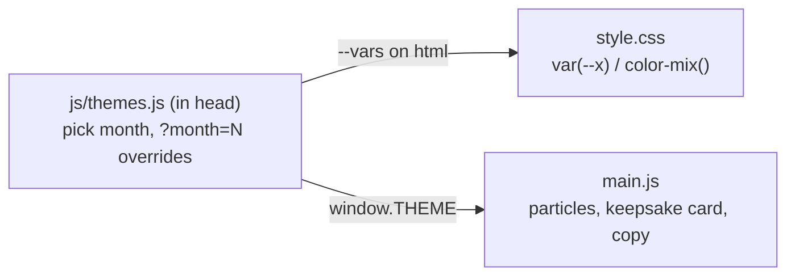

# Monthly themes — design

## Intent
The site should feel different every month. Same story and layout; the colors, ambient
particles and a line of mood copy change with the visitor's current month. Months that hold
our anniversaries (Jan, Apr, Aug) also mention them.

## Goals / non-goals
- Goal: 12 seasonal themes, picked automatically from the visitor's local month.
- Goal: no flash of the wrong theme on load.
- Goal: keepsake PNG, SVG heart, particles all follow the theme.
- Non-goal: layout/font changes per month; theme switcher UI; dark themes.
- Anti-goal: a month that looks broken or unreadable (contrast must stay comfortable).

## Approaches
- **A (chosen)** — `js/themes.js` loaded in `<head>`: one table, one entry per month
  (palette, particle shape, copy). Sets CSS variables on `<html>` before first paint.
- B — palettes as 12 CSS blocks + particle/copy table in JS. Rejected: each month split across two files.
- C — GitHub Action rewrites CSS monthly. Rejected: CI, server-time vs visitor-time, caching.

## How

- Each theme overrides a few base colors (`bg, paper, blush, peach, accent, accentDeep, gold, ink`);
  all tints are derived with CSS `color-mix()`, so a theme stays ~8 values.
- Particle shapes: `heart` (rises, today's behavior), `snow`, `petal`, `leaf` (fall, petals/leaves spin).
  Soft bokeh glows stay in every month, tinted by the palette.
- Footer shows `本月 · 十月 · 枫叶` + the month's one-line mood.
- `?month=4` previews April (for you; not linked anywhere).

## The 12 months (draft — edit freely)
| 月 | 名字 | 飘落 | 主色 | 本月一句 |
|---|---|---|---|---|
| 1 | 初雪 | 雪 | 喜庆红 | 新年第二天我们结婚，第七天是 Toby 的生日。(hero) |
| 2 | 红梅 | 花瓣 | 梅红 | 冷的时候，更想靠近你。 |
| 3 | 新柳 | 叶 | 嫩绿 | 春风一吹，什么都重新开始。 |
| 4 | 樱花 | 花瓣 | 樱粉 | 四月的最后一天，我们遇见了。(hero) |
| 5 | 蔷薇 | 花瓣 | 蔷薇红 | 日子开成了花。 |
| 6 | 栀子 | 花瓣(白) | 青绿 | 夏天的风里有一点甜。 |
| 7 | 荷风 | 心 | 荷粉 | 慢一点，陪你看完这个夏天。 |
| 8 | 百合 | 花瓣 | 百合橙 | 夏天的尾巴上，Lily 来到这个世界。(hero) |
| 9 | 桂子 | 雪(金色小花) | 桂金 | 风里都是桂花香。 |
| 10 | 枫叶 | 叶 | 枫红 | 秋天把思念染成了红色。 |
| 11 | 银杏 | 叶 | 银杏黄 | 一地金黄，是时间送的。 |
| 12 | 暖冬 | 雪 | 酒红 | 外面再冷，家里有灯。 |

## Left to the builder
Exact hex values per month (warm, muted, readable on `paper`); particle drawing details.
